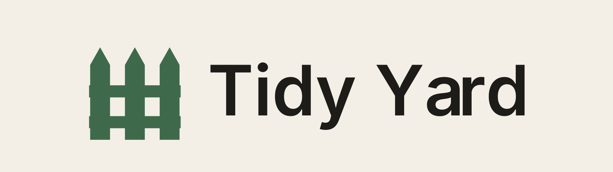

<p align="center">
  <picture>
    <source media="(prefers-color-scheme: dark)" srcset="Assets/Logo/TidyYard_Wordmark_Dark.png">
    
  </picture>
</p>

<p align="center">
  A calendar on your wallpaper, and boxes on your desktop that keep your files in order.
</p>

<p align="center">
  <a href="https://github.com/bingusxz/tidy-yard/releases/latest"></a>
  
  <a href="LICENSE"></a>
</p>

Tidy Yard is a Windows desktop app made of two things that live on your wallpaper:

- **A calendar widget** with events, reminders, checklists and your Google, Outlook or iCloud calendars.
- **Fences**: boxes on the desktop that each show a real folder, so loose files have a place to go.

It sits behind your windows and is built to be quick to read and quick to use. On Windows 11 it gets the acrylic glass look.

## Install

1. Open the [latest release](https://github.com/bingusxz/tidy-yard/releases/latest).
2. Download **`TidyYard-win-Setup.exe`** and run it.
3. Windows may say it protected your PC, because the installer is not code-signed. Click **More info**, then **Run anyway**.

You need Windows 10 (version 1809 or later) or Windows 11. If the .NET 8 desktop runtime is missing, the installer adds it.

**Updating:** open **Settings, General, Updates** and press **Check now**. Tidy Yard downloads the newest release, installs it and restarts. It also checks quietly in the background every few hours and tells you when a new version is ready. Your events, settings and fences are never touched by an update.

## The calendar

- Month, week and day views, with a day card for quick add and the agenda.
- Quick add understands plain text such as `Dentist 3pm` or `Pay rent tomorrow 9:30`.
- Events can have an end time or last several days. They can repeat every day, weekday, week, month or year, optionally until an end date, with "Skip this day" for a single exception.
- Drag an event to another day to reschedule it. Search (Ctrl+F) finds events or jumps to a date. Deleting an event or skipping a day has an Undo.
- Reminders arrive as Windows toast notifications, with snooze.
- Checklists on events.
- **Calendar links:** show events from Google Calendar, Outlook or iCloud by pasting the calendar's secret iCal link. Repeating events and time zones are handled. The link is stored encrypted for your Windows account, and your PC reads it directly with no server in between. The calendars are read-only here.
- Resizable, and it can be locked in place so it sits behind your windows.

## Fences

A fence is a box on the desktop backed by a real folder. Drag files in, drag them out, double-click to open.

- **Tabs.** One fence can hold several folders, switched with a tab bar that appears once there is more than one tab. Folders open inside the fence with a back button, and you can drop files onto a folder icon or a tab to move them in.
- **Roll up.** A rolled-up fence is a bare title strip. Hover it and it drops open to fit its contents, then rolls back up when you move away.
- **Fits its contents.** A fence grows or shrinks to show everything in it, up to three quarters of the screen, then it scrolls. Turn this off per fence if you prefer to set the height yourself.
- **Right-click** anywhere on a fence for its options: roll up, lock, layout, colour, text and more.
- **Three layouts:** grid, a single row, or a list.
- **Make each one yours.** Every fence has its own glass colour, and its own font, size and colour for the title and for the file names, set separately. The font list has search. The title can sit left, centre or right.
- **Rename it, the folder follows.** Renaming a fence also renames its folder, when Tidy Yard created that folder. A folder you picked yourself is never renamed.
- **Lock to the desktop** so a fence sits behind your windows and cannot be moved by accident.
- **Auto-sort** (off by default): new desktop files that match a rule, by file type or a word in the name, move into a fence or tab. Files already on the desktop are left alone, every move is logged, and the notification has an Undo button.
- **Tidy Desktop** sorts loose files into fences by type. It shows you the plan first, logs every move, and can undo the last one.

Files are only ever moved, never deleted or overwritten.

## Themes and settings

Three themes: **Paper** (warm off-white with a muted green accent), **Night Shift** (near-black with amber) and **Moss** (deep green with brass). Pick your own accent colour and background tint, and set how much of your wallpaper shows through the glass.

Settings has a sidebar with a page each for Appearance, Calendar, Fences, Auto-sort and General. You can hide the desktop icons, start Tidy Yard with Windows, and back up or restore everything.

## Your data

Everything lives in `%APPDATA%\TidyYard`:

| File | Contents |
| --- | --- |
| `tidyyard.db` | Events, reminders and checklists (SQLite) |
| `settings.json` | Settings and window positions |
| `fences.json` | Fence layout and look |
| `moves.log` | Every file move made by fences or cleanup |
| `error.log` | Errors, if any |

New fence folders are created in `Tidy Yard Fences` in your user folder.

Updates replace the program files only. Before the database layout changes, a copy is saved as `tidyyard.db.backup-vN` next to it.

Settings has **Back up** and **Restore**: one `.zip` with your events, checklists, settings and fence layout. A restore is checked first and applied the next time the app starts, after the current data is copied to a `backups` folder. Nothing is deleted. A deleted event can be undone for a few seconds, and is removed from the database for good after 30 days.

## Build it yourself

You need the [.NET 8 SDK](https://dotnet.microsoft.com/download/dotnet/8.0) on Windows.

```
dotnet build
dotnet run
```

Close any running copy of Tidy Yard before building, or the build cannot replace the program file.

The app is C# and WPF on .NET 8, using MVVM with [CommunityToolkit.Mvvm](https://github.com/CommunityToolkit/dotnet). Events live in SQLite, and fence layout and settings in JSON. The font is [Inter](https://rsms.me/inter/), bundled under the SIL Open Font License.

| Folder | What is in it |
| --- | --- |
| `Views`, `ViewModels`, `Models` | Windows, their logic, and the data |
| `Services` | Reminders, storage, themes, fences, updates, backup |
| `Interop` | The Windows API calls, all in one file |
| `Themes` | The three themes and the shared control styles |

## Publish a release

Installer and updates use [Velopack](https://velopack.io). The `vpk` tool is pinned in `.config/dotnet-tools.json`.

1. Close Tidy Yard, then double-click **`Build-Installer.bat`**, or run `.\release.ps1 -Version 1.0.4` in PowerShell. The version must be higher than every earlier build in `releases\`.
2. On GitHub, create a **Release** with a tag such as `v1.0.4` and attach every file from `releases\` that belongs to that version: the Setup file, the `.nupkg` packages, `releases.win.json`, `RELEASES` and `assets.win.json`.
3. Installed copies find it with **Check now**, or on their next background check.

Updates are read from this repository's Releases, so the repository has to be public. To use another host, set `UpdateFeed` in `settings.json` to a web address or folder holding the release files.

## Notes

- Tidy Yard runs from the tray. Closing the calendar leaves it running; use Quit in the tray menu to exit.
- Desktop pinning uses the WorkerW window, so it can behave differently on unusual shell replacements.
- Only an installed copy can update. A copy run from the build folder says so in Settings.

## License

[MIT](LICENSE). Inter is licensed separately under the SIL Open Font License (`Assets/Fonts/Inter-OFL.txt`).
